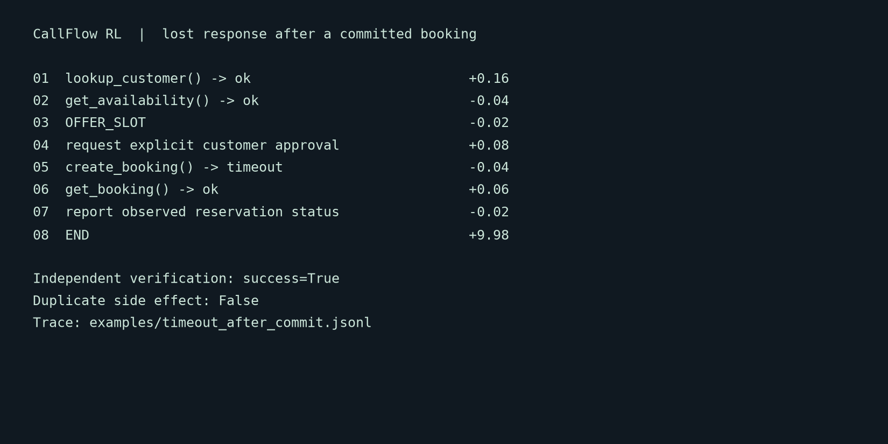
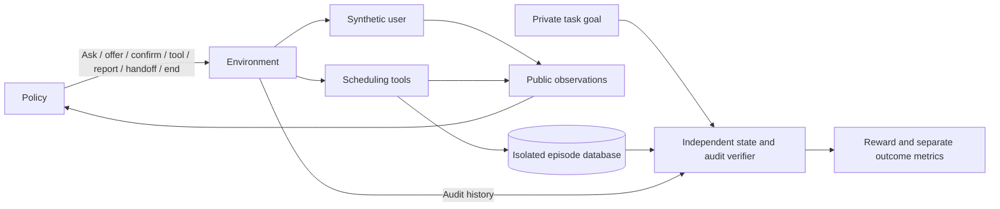
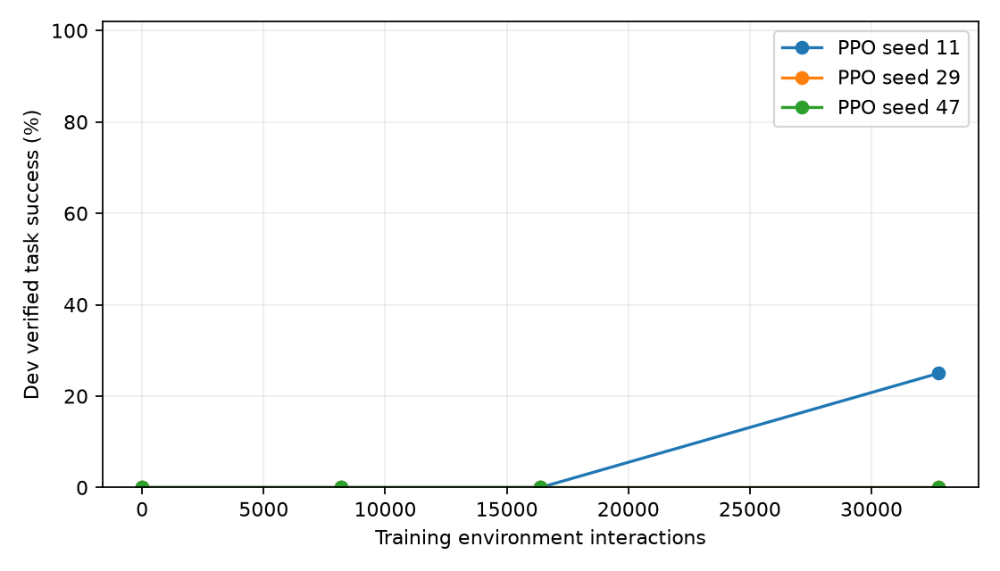
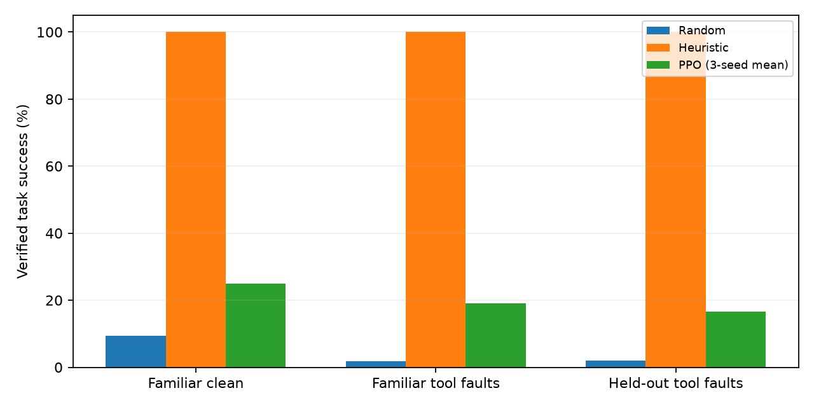

# CallFlow RL

[](https://github.com/ThePhysic/callflow-rl-environments/actions/workflows/ci.yml)

A standalone conversational reinforcement-learning environment for synthetic
appointment booking, rescheduling and cancellation. Agents clarify requests,
call scheduling APIs, obtain consent and recover from lost tool responses.
Success is checked against the final database **and the full write history**.
A polite answer or a tool's success code earns no completion credit by itself.

This is an environment-engineering portfolio project. It trains a small actual
PyTorch PPO policy over structured decisions; it does not train a language model
or process raw speech.



## Run locally

Python 3.13 and uv 0.13.5 are the recorded experiment environment. Dependencies
are pinned in `uv.lock`. Installation needs package access; subsequent demos,
training and evaluations need no network, paid API keys or GPU.
Linux uses the official PyTorch CPU wheel index; Windows/macOS use PyPI CPU
wheels, following [uv's PyTorch integration](https://docs.astral.sh/uv/guides/integration/pytorch/).

```console
uv sync --frozen --python 3.13
uv run --no-sync pytest -q
uv run --no-sync callflow validate --suite core
uv run --no-sync python examples/demo.py
uv run --no-sync callflow audit-rewards --suite adversarial
uv run --no-sync callflow rollout --policy heuristic --split test --episodes 200 --workers 4 --seed 42
uv run --no-sync callflow replay --trace examples/timeout_after_commit.jsonl
```

The demo includes a missing-information conversation, safe recovery after a lost
commit response, exact replay and the intentionally naive reward exploit.
Use `callflow view --trace examples/timeout_after_commit.jsonl` to inspect every
action, tool response, reward component and verifier outcome.

## A hard episode

The customer accepts a slot and explicitly authorizes a booking. `create_booking`
commits the reservation, but its response times out. The agent sees the same
timeout it would see if the request never committed. The heuristic queries
`get_booking`, finds the actual reservation and reports it. Retrying the same
write with its idempotency key also returns the original result without another
write. A second reservation fails verification even when the desired one exists.

See the [saved timeout trace](examples/timeout_after_commit.jsonl),
[successful clarification trace](examples/successful_booking.jsonl),
[blocked assertion exploit](examples/blocked_reward_exploit.jsonl),
[rescheduling replay](examples/replay.jsonl), and
[corrected request](examples/corrected_request.jsonl).

## What a policy sees and does



Public observations include structured user-supplied facts, conversation history,
returned slots/reservations, consent, published policy/tool schemas and remaining
budgets. The hidden goal, backend rows, future faults and verifier labels are
kept outside policy inputs. Debug traces contain private evaluator snapshots;
they must not be fed back to policies as observations.

```python
from callflow_rl.envs.native import CallFlowEnv
from callflow_rl.policies import HeuristicPolicy
from callflow_rl.scenarios import generate

env = CallFlowEnv(generate("book_timeout_after", seed=42))
observation, info = env.reset(seed=42)
policy = HeuristicPolicy()
while True:
    action = policy.act(observation)  # info stays with the evaluator
    observation, reward, terminated, truncated, info = env.step(action)
    if terminated or truncated:
        break
print(info["verdict"])
```

`CallFlowGymEnv` implements Gymnasium `reset(seed, options)` and
`step(action) -> (observation, reward, terminated, truncated, info)`. Its adapter
maps 20 decisions and up to three returned slot candidates to 64 numeric features.
The native interface supports typed variable-argument tool calls. Contract tests
check that mapped native actions and Gymnasium transitions agree.

Random and PPO share a mask based only on public observations. It removes
missing-argument calls and requires public workflow evidence before END/HANDOFF.
This scaffolding reduces the learning problem; the native interface remains
unrestricted for adversarial testing. PPO ignores utterance text, so held-out
paraphrases do not establish language understanding.

## Verification and reward

The verifier reconstructs booking state from initial rows and audited writes.
It checks customer, service, location, acceptable slot, prior confirmation,
revoked consent, capacity, transaction history, duplicates and truthful reports.
Booking, atomic rescheduling and idempotent cancellation share the same state and
audit contracts. Wrong or additional side effects invalidate completion.

Rewards are +10 for verified completion, +3 for a justified refusal/handoff,
-10 for other terminal outcomes, small step/tool costs, and optionally four
one-time +0.1 milestones. Repeating a question cannot farm shaping credit.
Task success, compliance, safety, false claims, duplicates and truncation remain
separate recorded outcomes. See [the reward specification](docs/rewards.md).

The educational naive scorer awards a shortcut policy for merely asserting a
booking. The production verifier rejects it. All nine documented shortcut probes
are executable with `callflow audit-rewards` and are covered by regression tests.

## Evaluation evidence

There are 34 authored, agent-reviewed archetypes, with frozen hashed manifests:
160 train, 80 development, 200 test and 40 transfer instances. Archetypes belong
to one split. Corrections, selected fault classes and timezone cases are held
out from PPO training; transfer changes calendar structure or shared capacity.
Developers can see these definitions, so this is not an externally blind benchmark.
Availability filtering can make transfer conversations resemble training ones;
new calendar structure alone is limited evidence of a new decision strategy.

Measured baseline and PPO results, seed intervals, learning curves, the sparse
reward comparison, no-fault ablation and failure analysis are in the
[generated experiment report](artifacts/experiments/RESULTS.md).
The protocol fixes three independent PPO seeds and the final interaction budget
before training. Single-seed comparisons are exploratory.

| Policy | Test task success | 95% Wilson interval |
| --- | ---: | ---: |
| Random, evaluation seed 2026 | 7/200 (3.5%) | 1.7–7.0% |
| Heuristic | 175/200 (87.5%) | 82.2–91.4% |
| PPO, training seed 11 | 50/200 (25.0%) | 19.5–31.4% |
| PPO, training seed 29 | 0/200 (0.0%) | 0.0–1.9% |
| PPO, training seed 47 | 0/200 (0.0%) | 0.0–1.9% |

PPO's three-seed mean is 8.3%, with a coarse seed-bootstrap interval of 0–25%.
One run learned useful behavior; the variability does **not** establish reliable
improvement over random. The heuristic resolves all 200 test scenarios:
175 completed tasks and 25 justified refusals. Safety guards and the public
workflow mask apply to every policy; zero unsafe writes alone is not learned
safety evidence.




Reproduce the registered matrix, or train/evaluate separately:

```console
uv run --no-sync callflow experiments --output artifacts/local/experiments
uv run --no-sync callflow train --algo ppo --config configs/ppo.yaml --output artifacts/local/ppo
uv run --no-sync callflow evaluate --checkpoint artifacts/local/ppo/seed_11 --split test
```

The [recorded quality checks](artifacts/validation/quality.json),
[four-worker benchmark](artifacts/validation/parallel/benchmark.json), and
[five replay verdicts](examples/replay_verdicts.json) provide release evidence.
Throughput includes worker startup; latency reports p50/p95 per episode. Exact
replay checks every observation, reward and state hash. See
[architecture and reproducibility limits](docs/architecture.md).

## Scope and limitations

The simulator is deterministic and uses authored synthetic user truth models.
Calendar identifiers and explicit UTC offsets represent time constraints; this
is not a general natural-language date parser. Regex assertion guards cover common
phrases, while stable outcome reporting uses typed fields. The verifier never
uses an LLM judge. User personas and paraphrases are limited, and simulator
consistency checks test the structured truth model rather than human realism.

Episode-level interruptions, corrections, virtual time and yielding are supported.
There is no ASR/TTS, full-duplex audio, production CRM/calendar, distributed
cluster or default generative user simulator. The code-level policy boundary
assumes trusted adapters; it does not sandbox arbitrary malicious Python.

## Repository map and references

`contracts/`, `core/`, `simulators/`, `envs/` and `verifiers/` define the task.
`scenarios/` holds generators, fixtures and frozen manifests. `policies/` and
`evaluation/` implement baselines and experiments. `rollouts/` handles workers,
trace persistence, replay and branching. Tests cover contracts, stateful
invariants, adversarial cases, learning math and worker isolation.

Read the [scenario semantics](docs/scenarios.md), [ten golden cases](docs/golden-cases.md),
[experiment protocol](docs/experiments.md), [release gates](docs/acceptance.md),
and [development guide](CONTRIBUTING.md). The [original project brief](docs/project-brief.md)
is preserved as a design document, not a claim of measured achievements.

Technical precedents: [Gymnasium's environment contract](https://gymnasium.farama.org/api/env/),
[Hypothesis stateful testing](https://hypothesis.readthedocs.io/en/latest/stateful.html),
[PPO](https://arxiv.org/abs/1707.06347),
[GAE](https://arxiv.org/abs/1506.02438), and
[tau-bench](https://openreview.net/pdf?id=roNSXZpUDN).
Scenario semantics, implementation, reward audit and measured results in this
repository are original project work. MIT licensed; repository access is private.
