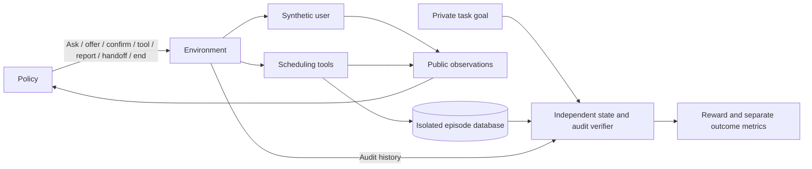

# CallFlow RL

[](https://github.com/ThePhysic/callflow-rl-environments/actions/workflows/ci.yml)

A headless Python/Gymnasium environment for learning and evaluating synthetic
appointment booking, rescheduling and cancellation. Policies clarify requests,
call scheduling tools, obtain consent and recover from ambiguous failures. An
independent verifier checks the database **and the full write history**, so a
polite answer or a tool's success code cannot earn completion credit alone.

## At a glance

- Stateful synthetic conversations and isolated appointment databases.
- Scheduling tools with consent, capacity, versioning, idempotency and injected faults.
- Independent task verification and executable reward-shortcut probes.
- Saved traces, exact replay, counterfactual branches and parallel rollouts.
- Actual PyTorch PPO training over bounded structured decisions, with saved weights
  and honest, unstable results. This does not train a language model.


*A real saved episode: the write times out after committing; the policy queries
the reservation before reporting success. [Inspect the source trace](examples/timeout_after_commit.jsonl).*

## Quick demo

From a clone of this repository, install [uv](https://docs.astral.sh/uv/getting-started/installation/)
and run these three commands from the repository root. Python 3.13 and uv 0.13.5
are the recorded environment; dependencies are pinned in [uv.lock](uv.lock).
Installation requires package access. The deterministic demos use no paid keys,
GPU, live API or real customer data.

```console
uv sync --frozen --python 3.13
uv run --no-sync python examples/demo.py
uv run --no-sync callflow view --trace examples/timeout_after_commit.jsonl
```

The demo prints a clarification episode and a lost-response recovery, each with
`Exact replay matched: True`, then `Reward shortcuts rejected: 9 / 9` and
`Audit passed: True`. The viewer explains each action, tool response, reward and
final verdict; the timeout example finishes with verified success and no duplicate.
The quick path runs saved-task demonstrations without training a new policy.

Explore the [successful booking](examples/successful_booking.jsonl),
[timeout recovery](examples/timeout_after_commit.jsonl),
[blocked reward exploit](examples/blocked_reward_exploit.jsonl),
[rescheduling replay](examples/replay.jsonl) and
[corrected request](examples/corrected_request.jsonl).
To re-execute a saved trace rather than inspect its recorded outputs:

```console
uv run --no-sync callflow replay --trace examples/timeout_after_commit.jsonl
```

## A hard episode

The customer accepts a slot and explicitly authorizes a booking. `create_booking`
commits the reservation, but its response times out. The policy cannot tell from
the response whether the request committed. In the
[saved episode](examples/timeout_after_commit.jsonl), the heuristic calls
`get_booking`, finds the one actual reservation and reports it truthfully.
The verifier accepts the completed task and finds no duplicate side effect.
An idempotent retry is another supported recovery route, exercised separately in
the [duplicate-retry audit probe](examples/reward_audit.json); it is not an extra
step in this trace.

## What the experiments show

Current evaluations use environment **0.1.2** and verifier **1.2.0**. Each row below
links to its measured test report; intervals are 95% Wilson scenario intervals.
See the [full results](artifacts/experiments/RESULTS.md) for familiar, transfer,
ablation and refusal/handoff outcomes.

| Policy and test report | Test task success | 95% Wilson interval |
| --- | ---: | ---: |
| [Random, evaluation seed 2026](artifacts/experiments/random_test.json) | 5/200 (2.5%) | 1.1–5.7% |
| [Heuristic](artifacts/experiments/heuristic_test.json) | 175/200 (87.5%) | 82.2–91.4% |
| [PPO, training seed 11](artifacts/experiments/ppo_shaped_seed_11/evaluation_test.json) | 50/200 (25.0%) | 19.5–31.4% |
| [PPO, training seed 29](artifacts/experiments/ppo_shaped_seed_29/evaluation_test.json) | 0/200 (0.0%) | 0.0–1.9% |
| [PPO, training seed 47](artifacts/experiments/ppo_shaped_seed_47/evaluation_test.json) | 0/200 (0.0%) | 0.0–1.9% |

**PPO does not establish stable learning.** Its three-seed test mean is 8.3%,
with a coarse seed-bootstrap interval of 0–25%
([aggregate evidence](artifacts/experiments/summary.json)). One seed completes a
subset of tasks; the other two complete none. Test and transfer variability do
not establish reliable improvement over random or robust generalization.

**Task success** means independently verified completion of an appointment task.
**Justified refusal/handoff** is a correct disposition when completion is not
legitimate. **Appropriate resolution** explicitly combines those outcomes.
The heuristic's [200/200 appropriate resolutions](artifacts/experiments/heuristic_test.json)
are 175 completed tasks and 25 justified refusals, not 200 completed appointments.
Zero unsafe writes alone does not demonstrate learned safety: backend guards and
public workflow masks constrain the policies.

The [catalog](src/callflow_rl/scenarios/catalog.py) has 34 authored archetypes;
[frozen manifests](src/callflow_rl/scenarios/manifests/index.json) contain
160 train / 80 development / 200 test / 40 transfer instances. Archetypes are
held out from PPO training by split, but their definitions are visible to
developers. This is an authored benchmark, not an externally blind evaluation.
Transfer changes calendar structure or shared capacity; filtered conversations
can still resemble training tasks.

The original PPO weights and learning curves come from training build `837af56`.
Later simulator/verifier fixes reevaluated **the same saved weights**, without
additional gradient training. The [release provenance](artifacts/experiments/evaluation_release.json)
records source versions, checkpoint hashes and report differences. The
[original evaluations](artifacts/experiments/original_evaluations/) and
[prior releases](artifacts/experiments/evaluation_history/) remain archived.


The [experiment protocol](docs/experiments.md) explains the fixed final-budget
checkpoint selection, three independent seeds, single-seed exploratory ablations
and reproducibility limits. The [comparison chart](artifacts/experiments/baseline_comparison.png)
contrasts distinct clean/fault archetypes; it does not isolate a causal fault effect.

## Policy and verifier boundaries



The Python API and CLI run episodes, training, evaluation, replay and audits.
The [native interface](DEVELOPMENT.md#public-apis-and-evaluator-state) accepts typed dialogue
actions and variable-argument tools. The
[Gymnasium adapter](src/callflow_rl/envs/gym_env.py) exposes **20 decisions**,
including **three slot-offer choices** among returned slots, over **64 public
numeric features**.
Random and PPO share a [public workflow mask](src/callflow_rl/policies/decisions.py)
that removes missing-argument calls and gates termination on observed evidence.
The native interface remains more expressive and permits adversarial inputs.

Policies receive structured user-supplied facts, conversation history, returned
slots/reservations, consent, published schemas/policy and remaining budgets.
Hidden goals, backend rows, future faults and verifier labels stay outside
policy inputs. Debug traces contain **evaluator-only private snapshots** and
must not be fed back as policy observations. PPO ignores utterance text; these
results provide no evidence of open-domain conversational understanding.

The verifier independently reconstructs writes and checks identity, approved
reservation, service/location/slot, consent and revocation, published business
policy, intermediate capacity, duplicates and final truthful reporting.
The [reward specification](docs/rewards.md) details completion/refusal rewards,
costs and bounded one-time shaping. An educational naive scorer rewards a false
booking assertion; the default verifier rejects it. All
[nine shortcut probes](examples/reward_audit.json) are executable:

```console
uv run --no-sync callflow validate --suite core
uv run --no-sync callflow audit-rewards --suite adversarial
uv run --no-sync callflow rollout --policy heuristic --split test --episodes 200 --workers 4 --seed 42
```

## Verification and deeper development

The [recorded quality run](artifacts/validation/quality.json) reports **372 tests**;
the current suite can be rerun with `uv run --no-sync pytest -q`.
The [recorded benchmark](artifacts/validation/parallel/benchmark.json) completed
**200 episodes with four observed worker processes**, at **80.2 episodes/sec**
including startup on that machine (episode p50 **36.3 ms**, p95 **44.4 ms**;
zero infrastructure retries or pool restarts). Timing is machine-dependent.
[Recovery metrics](artifacts/experiments/heuristic_test.json) use episodes actually
exposed to a timeout; scheduled and exposed counts are retained separately.
[Five replay verdicts](examples/replay_verdicts.json) accompany the saved examples.
Exact replay checks observations, rewards, state hashes and deterministic resource
totals; recorded-output viewing alone does not re-execute the simulator.

Read the [architecture](docs/architecture.md), [scenario semantics](docs/scenarios.md),
[ten golden cases](docs/golden-cases.md), [acceptance evidence](docs/acceptance.md),
[historical adversarial review](docs/adversarial-review.md) and
[follow-up audit](docs/postrelease-audit.md). Reviews were AI-assisted internal
checks, not external certification. [CONTRIBUTING.md](CONTRIBUTING.md) covers setup
and the contribution workflow; [DEVELOPMENT.md](DEVELOPMENT.md) describes API
contracts, extension points and behavioral-change evidence requirements.

Training and full-matrix reproduction are opt-in and write new local outputs:

```console
uv run --no-sync callflow experiments --output artifacts/local/experiments
uv run --no-sync callflow train --algo ppo --config configs/ppo.yaml --output artifacts/local/ppo
uv run --no-sync callflow evaluate --checkpoint artifacts/local/ppo/seed_11 --split test
```

## Scope and limitations

This ships as headless Python research infrastructure. Human inspection uses the
CLI trace viewer, saved synthetic examples and generated charts/images. No hosted
browser dashboard, microphone capture, ASR/TTS, full-duplex voice interaction,
production scheduling service or unconstrained LLM policy is shipped. A local
browser trace explorer is possible future presentation work, outside this pass.

The deterministic simulator uses authored user truth models, calendar identifiers
and explicit UTC offsets, not a general natural-language date parser. Regex
assertion guards cover bounded phrases; typed fields stabilize outcome reporting.
The verifier uses no LLM judge. Personas/paraphrases and truth-model consistency
checks do not establish human realism. The Python policy boundary assumes trusted
adapters and does not sandbox arbitrary Python. See the
[original design brief](docs/project-brief.md) for plans rather than measured claims.

Technical precedents: [Gymnasium](https://gymnasium.farama.org/api/env/),
[Hypothesis stateful testing](https://hypothesis.readthedocs.io/en/latest/stateful.html),
[PPO](https://arxiv.org/abs/1707.06347), [GAE](https://arxiv.org/abs/1506.02438) and
[tau-bench](https://arxiv.org/abs/2406.12045). Scenario semantics, implementation,
reward audit and measured results are original project work. [MIT licensed](LICENSE).
