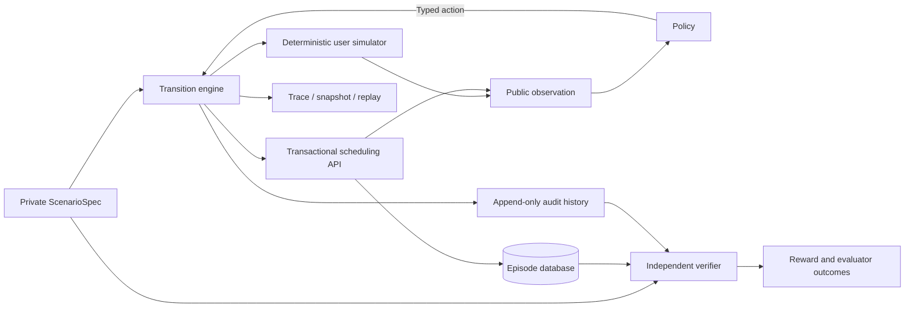

# Architecture and trust boundaries

CallFlow is a text-first, partially observed appointment simulator. Each reset
owns a synthetic customer/calendar datastore, dialogue state, fault schedule,
event queue, virtual clock, audit log and isolated seeded random generators.
There are no real bookings, real customer records or live business integrations.

The policy adapter receives only a deep copy of the public observation. It does
not receive the environment object, private goal, evaluator `info`, reward
labels or future event schedule. The runner records these separately. This is an
API trust boundary within a trusted Python process, not a security sandbox for
untrusted Python plugins. A policy with arbitrary process access could inspect
memory; such code must be isolated separately before deployment.

The user simulator answers from its structured truth model, remembers offers
and confirmations, and applies authored corrections/interruptions at specified
virtual turns. The scheduling API enforces session identity, approval, optimistic
versions, capacity and idempotency using runtime session state. The independent
verifier checks the private task against final state and audit history. A tool
success response and a conversation claim are insufficient to establish success.

The native API accepts variable-argument typed tools and dialogue events. The
Gymnasium adapter offers a fixed bounded decision list and numeric encoding
derived solely from public observations. It does not parse unrestricted English
or train an LLM. Random and PPO adapters additionally share a public workflow
mask: missing-argument choices are removed, END requires a reported result or
refusal, and HANDOFF requires public evidence. This scaffolding reduces the
learning problem and must be considered when reading the results. Repetition,
slot selection, clarification, tool queries and recovery decisions remain.
The native interface stays unrestricted for premature termination and malformed
or unauthorized action tests; neither mask nor encoding reads hidden goals.

The runner supports independent worker processes. Episode seed, build source
fingerprint, scenario/hash, policy version, full action/response stream, pre/post
state hashes, rewards, verifier decisions and resource consumption are recorded.
Infrastructure retries appear in trace metadata rather than being counted as
additional policy decisions.

## Replay and branching

JSONL traces have a header, ordered step records and a checksum footer. Parquet
exports preserve the same records as JSON strings to avoid lossy type inference.
Traces contain evaluator-only snapshots and private goals: they are debugging
artifacts, not valid policy inputs or policy-visible demonstration datasets.

Exact replay re-executes recorded actions from the seed and frozen scenario,
checking observations, rewards, termination flags, evaluator info and state hashes
at every transition. It rejects a source build mismatch unless explicitly allowed
for investigation. Playback returns saved outputs without calling simulators;
it supports inspection of stochastic/external outputs but does not prove their
causal validity. No LLM or external simulator is required by this release.

Counterfactual branching restores a saved pre-action snapshot (or reconstructs
one from the recorded prefix), changes an action or evaluator-injected fault,
and runs a continuation policy. The original trace and scenario are unchanged.

## Reproducibility limits

Exact matching assumes the same transition implementation, scenario, seed and
actions. Source fingerprints exclude checkpoint contents, so policies/checkpoints
also have explicit versions in experiment artifacts. Numerical training results
can differ across PyTorch versions or hardware; pinned dependencies, CPU thread
settings, independent run seeds and fixed evaluation suites make this visible.
Measured simulator results are evidence about these authored synthetic tasks,
not evidence of production speech or open-domain conversational competence.
